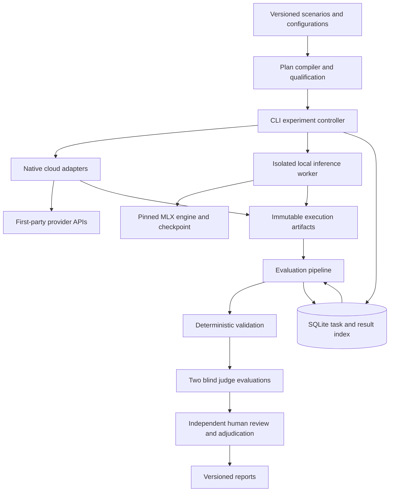

# ArchDecisionBench architecture proposal

Based on `temp/Spec.md`, specification v1.2. This proposes the benchmark harness; the personal workflow platform remains the problem presented to candidate models.

## Architecture decision

**Language decision: Python selected.** Implement the experiment controller, provider adapters, local inference worker, evaluation, and reporting in Python. This keeps MLX integration and analysis in the same ecosystem. Use strict type checking and runtime validation at external boundaries. A future web frontend can use TypeScript while the benchmark logic remains in Python.

Build a Python modular monolith with a CLI, native cloud adapters, an isolated local inference worker, and a separately executable evaluation pipeline. Use the specification's proposed stack: Pydantic schemas, SQLite metadata, immutable files for execution artifacts, and Pandas plus Markdown/CSV for reporting.

The full experiment has 144 candidate responses. A single controller with persisted task dependencies is sufficient for this workload. Keep orchestration deterministic and explicit. Application modules should have clear interfaces so workers or storage can move elsewhere if future experiment sizes justify that change.



## Module responsibilities

| Module | Responsibility |
|---|---|
| `domain` | Typed scenarios, configurations, task graph, execution records, evaluations, and provenance |
| `planning` | Compile a frozen experiment plan; enforce qualifications, budgets, and branch dependencies |
| `execution` | Schedule tasks, manage attempts, resume interrupted experiments, and enforce concurrency |
| `adapters/cloud` | Native serialization, execution, response parsing, continuation, and capability evidence |
| `adapters/local` | Checkpoint verification, template rendering, tokenization, generation, and continuation |
| `workers` | Local process lifecycle, warm-up, model reuse, and resource monitoring |
| `storage` | SQLite repository and immutable artifact storage with hashes |
| `evaluation` | Validation, blinded judge packets, scoring, review selection, and adjudication |
| `reporting` | Quality, completion, cost, latency, resource, classification, and provenance reports |
| `cli` | Thin commands invoking these modules |

Dependencies point toward the domain schemas. Neither execution adapters nor the controller need to import scoring logic. Reporting reads persisted results and never invokes a model.

Every pipeline stage consumes immutable inputs and publishes new immutable outputs. Once an LLM response is captured, validation, judging, human review, adjudication, classification, and reporting add derived records without changing that response or any earlier stage's results. Corrections and reruns create new records with explicit lineage.

## 1. Compile and freeze an experiment

The input is an experiment YAML referencing versioned scenarios, model configurations, inference profiles, repetitions, qualification records, and an evaluation policy. Compile it into an immutable `ExperimentPlan` before scored execution.

The compiled plan contains resolved configurations, prompt hashes, dependency versions, source revision and dirty-tree state, rubric revision, pricing snapshot, scheduling policy, retry rules, and artifact schema version. Preserve configuration bytes as well as hashes. A Git commit alone does not identify uncommitted scenario or configuration changes.

Keep public scenario prompts and private evaluation material in separate directories and schemas. Construct candidate prompts from the scenario requirements and round instructions; never send the entire specification, which includes scoring and reference properties.

Qualification is its own persisted operation. A configuration needs evidence of endpoint/checkpoint identity, parameter support, continuation support, sufficient context, and local memory compatibility before admission. Named models and repositories in the specification remain candidates until verified against their first-party sources. This proposal does not verify their availability or compatibility.

Store parameter state separately from value: `explicit`, `omitted`, `unsupported`, `ignored`, or `unknown`. Also distinguish documented defaults from observed effective values and attach the source and verification date. Unknown settings must remain unknown.

## 2. Execute an explicit branching graph

Each configuration has three independent repetitions. Each repetition has four planned response tasks:

```text
fresh conversation -> R1 baseline -> immutable baseline snapshot
                                      |-> R2 reliability
                                      |-> R3 security
                                      |-> R4 evolution
```

Each child receives the original system/user messages, that repetition's baseline assistant response, and its own follow-up. It receives no sibling response. There is no conversation state shared across repetitions.

Store both a canonical semantic conversation and adapter-owned native continuation state. The latter may contain signed thinking blocks, provider response references, special tokens, or other required state. A plain assistant string is insufficient as the continuation contract.

Adapters must demonstrate that a baseline can be forked without mutation or replay it in a supported native form. If a provider only offers mutable sessions, create isolated branches using its supported mechanism. If faithful branching is impossible, report the configuration as incompatible. Record expiry and replay limitations for remotely held state.

The controller schedules cloud tasks under explicit per-provider concurrency/rate limits. Local performance runs use an exclusive host lease: one loaded benchmark model, with cloud execution and judging paused to avoid controller or inference contention. Record configuration order and cache policy. Run the three repetitions with fresh conversational state even when keeping the same model loaded.

## 3. Preserve native behavior behind a narrow adapter boundary

Use these conceptual operations:

```python
qualify(config, requirements) -> QualificationReport
prepare(conversation, native_state, config) -> PreparedInvocation
execute(prepared, artifact_sink) -> NativeExecution
extract(native_execution) -> CandidateResponse
fork_state(native_execution) -> ContinuationSnapshot
```

Common return types provide identifiers, status, final answer, metric observations, and artifact references. Provider-specific request/response bodies and continuation state remain native data. A shared interface must not force every provider into a common sampling or reasoning scheme.

For cloud adapters, capture the actual serialized request at the transport boundary, after SDK serialization. Redact authentication and sensitive transport fields before persistence. Capture response bodies, stream events where used, errors, request IDs, SDK versions, and observable stop/usage metadata. Do not persist secrets through exception logs.

Disable hidden SDK retries or instrument every wire attempt. Never silently substitute a model or change a generation parameter.

For local adapters, capture the rendered input and token IDs actually passed to the engine, the loaded checkpoint manifest, template/tokenizer hashes, and effective generation settings. Archive exposed reasoning only where permitted; judges receive the final answer and relevant task conversation rather than privileged reasoning traces.

## 4. Isolate local inference and qualify the complete workload

Run MLX generation in a worker subprocess, with the controller retaining scheduling and persistence. Use a pinned worker environment for each qualified engine combination. Keep checkpoints outside the source repository and reference their verified manifests.

The worker loads a pinned checkpoint, performs a fixed unscored warm-up, and serves sequential generation requests. Persist load duration separately from warm inference. End or explicitly invalidate caches between independent conversations according to the recorded policy.

Measure process/engine memory separately from host memory pressure and swap. A controller-side sampler should survive worker failure so an out-of-memory exit retains diagnostic evidence. Missing measurements carry a reason, rather than becoming zero.

Preflight must cover the required baseline and follow-up context envelopes, including the permitted baseline output length and reserved follow-up generation budget. Recheck actual context before each invocation. A short successful prompt cannot qualify the 35B configuration on a 32 GB machine. Failure to fit produces an explicit qualification or execution result; changing precision, engine, context policy, or output budget creates a new configuration revision.

## 5. Persist tasks, attempts, and artifacts separately

Use the following logical data model:

```text
Experiment
  -> frozen Configuration and Scenario revisions
  -> Repetition
       -> ResponseTask (round, baseline parent)
            -> InvocationAttempt
                 -> request / response / metrics / native state artifacts
            -> CandidateResponse (source attempt ID and artifact hashes)
  -> EvaluationRun (frozen response IDs/hashes and evaluation policy)
       -> ValidationResult (source response)
       -> BlindedPacket (source response and transformation revision)
       -> JudgeEvaluation (packet and judge configuration)
       -> HumanReview (packet and rubric revision)
       -> Adjudication (exact judge evaluation and human review IDs)
       -> ArchitectureClassification (source response and classification policy)
  -> ReportRevision (exact evaluation result IDs and reporting policy)
```

SQLite is the structured index and task ledger. Immutable files are the execution evidence. Store large native payloads and token sequences in files rather than wide database columns; every database reference includes its content hash and schema version. Workers return records to the controller, which is the database writer.

Published stage results are append-only in both SQLite and artifact storage. Each result records its exact input IDs and content hashes, configuration/policy revision, producing code revision, and output hashes. Storage rejects updates or deletion of published result rows and overwriting of published artifact paths. A corrected extraction, score, or review creates a new record that can reference the record it supersedes; existing downstream records retain their original inputs.

Operational task state, leases, and progress indexes may change while work proceeds. Keep these separate from published evidence and results. Evaluation and reporting operations can read upstream records and append their own outputs, but cannot modify upstream evidence or results.

Suggested artifact layout:

```text
results/<experiment-id>/
  manifest.json
  plan.json
  artifacts/<attempt-id>/
    canonical-messages.json
    native-request.json
    native-response.json
    continuation-state.json
    final-answer.txt
    metrics.json
    rendered-prompt.txt       # local
    input-token-ids.json      # local
  evaluations/<evaluation-id>/
  reviews/<review-id>/
  reports/<report-revision>/
```

Write artifacts through temporary files and atomic rename; register hashes and mark an attempt complete in a database transaction only after its evidence is durable. Startup reconciliation detects incomplete attempts, missing artifacts, and unregistered files. Database and filesystem writes are not one atomic transaction.

Keep eligibility, execution status, response validity, and evaluation status separate. An unavailable judge does not make the candidate invocation fail. An infrastructure crash is not a confirmed architecture critical failure.

Track every retry as a new attempt. Persist the attempt-selection policy before running: for example, retain the first successful attempt after eligible transient transport failures. An ambiguous provider timeout may already have incurred cost; preserve that uncertainty. Do not regenerate weak or truncated answers until one scores better. A failed baseline blocks its dependent follow-ups with an explicit reason.

## 6. Evaluate from frozen response artifacts

Evaluation is separately resumable and can be rerun under a new rubric without regenerating candidate responses. Before evaluation starts, freeze an `EvaluationRun` manifest containing the exact response IDs/hashes and the full evaluation policy: rubric and reference properties, judge configurations and prompts, packet transformations, review-selection rules and seed, adjudication rules, and scoring code revision. Rerunning evaluation creates a new run and new derived records. Resume appends missing work to the same run without replacing completed results; retries remain separate attempts with a persisted selection policy.

1. **Validate.** Check output presence, truncation, artifact integrity, and mechanically checkable requirements. Section coverage is a review signal; correctness requires evidence and judgment.
2. **Build blinded packets.** Include the public task, relevant baseline conversation, final answer, private rubric, and reference properties. Exclude provider, model configuration, timing, cost, and file paths that reveal identity. Preserve any narrowly applied identity masking as an auditable transformation.
3. **Judge independently.** Prefer two different judge model families with frozen configurations. Neither sees the other's assessment. Require per-dimension ratings, cited response evidence, and critical-failure candidates. Candidate text is untrusted evaluation input and cannot modify the judge instructions or invoke tools.
4. **Collect independent human reviews.** Export blinded review packets and import structured scores. Reviewers submit before seeing judge scores. Select all critical-failure candidates, disagreements, high/low examples, and a reproducible stratified sample of at least 20% of the remaining responses.
5. **Adjudicate.** Preserve original judge and human records. Add a separate adjudication record documenting confirmed failures, disagreements, and the final scoring decision.

Compute the rubric score in code:

```text
raw_score = 100 * sum(applicable_weight * rating)
                  / (4 * sum(applicable_weight))

adjusted_score = min(raw_score, 40) if critical_failure_confirmed
                 else raw_score
```

Round 1 excludes the adaptation dimension. Reference properties should describe necessary guarantees and defensible mechanisms, rather than prescribe one technology stack. Run architecture classification as a separate output so choosing a particular architecture category does not determine quality.

## 7. Report quality and operational outcomes separately

Generate cloud, local, and combined quality reports from the same evaluation records. Include completion and qualification coverage beside quality scores so a model succeeding on only one easy round cannot appear equivalent to one completing the suite.

Each report revision freezes its input manifest, including the evaluation run and exact validation, judge, human review, adjudication, and classification records used. Resolve any selection before publishing and never look up a mutable "latest result" when reproducing a report. Reject inputs from incompatible evaluation policies; an incomplete evaluation run must be reported as incomplete rather than filled with results from an earlier run. Subsequent analysis publishes a new report revision and leaves prior reports and their inputs intact.

Report uncapped and adjusted quality, critical-failure rate, completion rate, acceptable-response rate, variation across repetitions, and architecture-choice stability. Present per-round results before any combined score. The four branches within a repetition share a baseline and must not be treated as independent scenarios. With one scenario and three repetitions, uncertainty estimates are descriptive and cannot establish broad architecture competence.

Cost reports distinguish candidate generation, qualification/warm-up, retries, judge inference, and total experiment spending. Keep local electricity estimates and amortized hardware costs separate. The scenario's $30 monthly platform budget is a candidate design constraint, not the benchmark's execution budget.

Preserve pricing snapshots, cache accounting, measurement coverage, and local hardware context. Unknown cost or energy remains unknown. Compare configurations as configurations; differences between distinct Qwen checkpoints cannot isolate the causal effect of model size.

## Implementation sequence

1. Define domain schemas, artifact storage, task ledger, and a fake adapter. Verify branch isolation, crash/resume behavior, and manifest integrity without paid calls.
2. Add one native cloud adapter and one qualified local configuration. Complete a baseline plus three branches and verify native state capture and local memory behavior.
3. Add the full evaluation path and a report, including an independent human review import. Calibrate the rubric, thresholds, and aggregation rules using this complete vertical slice.
4. Add the remaining pilot adapters and execute the specified five-configuration pilot: 60 responses and 120 judge evaluations, excluding preflights and retries.
5. Freeze experiment and evaluation policies, qualify the remaining roster, and execute the full experiment.

Tests should focus on the experimental invariants: sibling branch isolation, independent repetitions, native-state preservation, redaction, immutable configuration identity, persisted retry selection, context rejection, resume recovery, score normalization/capping, and blinded judge packets. Verify that every downstream stage leaves upstream rows and artifact hashes unchanged, corrections preserve prior results, and a partial evaluation rerun cannot change an existing report or mix evaluation policies.

## Decisions to settle during calibration

The specification establishes the major constraints but leaves several policies open. Version these before publishing results:

- **Acceptable response:** Minimum adjusted score, required completion/eligibility, and exclusion of confirmed critical failures. This determines cost per acceptable response.
- **Aggregation:** Dimension aggregation across judges, adjudication precedence, round weighting, and treatment of missing responses. Always show missingness independently of conditional quality.
- **Disagreement:** Numeric score-distance and critical-failure disagreement rules that trigger human review.
- **Judge selection:** Judge identities, independence policy, and handling of self-family evaluation bias.
- **Generation limits:** Per-configuration budgets that accommodate native reasoning while preserving the same public deliverable and explicit truncation outcomes.
- **Operational limits:** Qualification thresholds for swap, memory pressure, minimum context, retries, and spending.
- **Sampling and uncertainty:** Review strata, review-selection seed, stability metric, and analysis unit for paired comparisons.

The first milestone should be one complete, auditable experiment path through generation, branching, evaluation, human review, and reporting. That will expose integration and measurement problems before expanding to the full provider roster.
